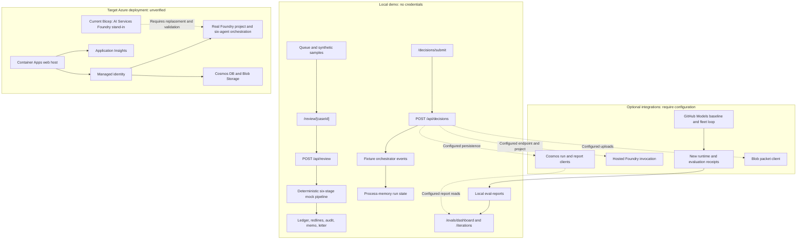

# Architecture

Trace a synthetic permit packet into evidence and staff-reviewed drafts. Separate the runnable mock experience from optional clients and the target Azure deployment.

## Distinguish the execution paths

Inspect the original [diagram export](architecture.excalidraw.svg) and [editable source](architecture.excalidraw) as a conceptual system sketch. They remain unchanged. Use the diagram above to distinguish current execution from optional and target components.

## Follow the web paths

Serve the UI from `apps/web` with Next.js 16. Read three hand-authored synthetic cases from `packages/shared/src/samples/index.ts`.

| Surface | Current behavior |
| --- | --- |
| `/` | Lists the sample packets |
| `/review/[caseId]` | Shows packet fields and calls `/api/review` for result tabs |
| `/api/review` | Always calls `runReviewPipeline` from the mock package export |
| `/decisions/submit` | Selects a known synthetic case and creates a run |
| `/decisions/[id]` | Shows run events and agent status through the decision stream |
| `/api/decisions` | Uses fixture orchestration without Foundry configuration. Can persist runs and upload packet JSON when clients are configured. |
| `/evals/dashboard` and `/iterations` | Read local round receipts or configured Cosmos reports |

Keep review results separate from decision event streams. The mock review route does not become model-backed when Azure environment variables are set. Fixture events include illustrative elapsed values and links to existing iteration artifacts. They do not prove six hosted agents executed for the selected case.

Use process-memory state for local decision runs. It is not durable across process restarts or replicas. Unknown run IDs can resolve to fixture or generated views. A rendered run page alone does not establish successful persistence.

## Trace the review stages

Run `packages/foundry/src/mock/pipeline.ts` for the credential-free review path:

1. Classify the pathway and specialist routing.
2. Return tutorial bylaw snippets relevant to the packet.
3. Compile numeric gaps and document evidence.
4. Audit completeness and applicant-support flags.
5. Generate proposed redlines.
6. Draft a staff memo and applicant letter.

Treat these as deterministic teaching rules with simplified policy content. The mock retriever does not query a Foundry vector store. Require a staff reviewer to verify every draft and citation before any use outside the tutorial.

Keep agent source under `agents/<agent-id>/` for the separate model-backed runtime. Follow the [fleet playbook](fleet-mode-playbook.md) for model access, scoped proposals, schema guards, reruns, and operator decisions. Do not confuse a UI mock run with a scored fleet iteration.

## Preserve data boundaries

Index only approved public corpus content for retrieval. Track source URLs, versions, rights statements, and hashes in [`datasets/policy-corpus/corpus-manifest.van-ssmuh.json`](../datasets/policy-corpus/corpus-manifest.van-ssmuh.json).

Keep oracle material evaluation-only. Keep dev case content, every sealed `.age` file, and oracle paths outside sub-agent context. Keep train, dev, and sealed holdout roles separate. Follow specs 001 and 002 for evaluation and provenance rules.

Restrict fleet sub-agents to their explicit context allow-lists and declared outputs. Scrub their environment to approved variables. Keep holdout keys and Azure secrets outside that context. Treat the CLI orchestration and artifact guard as a separate trust boundary from the unauthenticated web UI.

## Interpret evaluation receipts

Compute PRQS with `packages/evaluator`. Read existing reports under `eval-reports/`, rather than treating dashboard display as a fresh evaluation.

Report the existing train-only deterministic PRQS change as 80.96 to 86.49. Keep overlapping bootstrap intervals, M10/M11 regressions, null M12/M13, and one runtime failure visible. Both hard-freeze specs still contain null freeze dates and commits. Do not claim full judged quality, holdout generalization, or a frozen benchmark.

## Configure optional Azure clients

Use the server-side environment names from the source and Bicep. Leave them unset for the local fixture path. Consult [`infra/README.md`](../infra/README.md) for the emitted environment contract.

| Integration | Settings |
| --- | --- |
| Identity | `AZURE_CLIENT_ID` for `DefaultAzureCredential` |
| Cosmos | `SRS_COSMOS_ENDPOINT`, `SRS_COSMOS_DATABASE_NAME`, `SRS_COSMOS_RUNS_CONTAINER_NAME`, `SRS_COSMOS_REPORTS_CONTAINER_NAME` |
| Blob | `SRS_STORAGE_ACCOUNT_NAME`, `SRS_STORAGE_UPLOADS_CONTAINER_NAME`. The web client also accepts `SRS_STORAGE_ACCOUNT`. |
| Hosted orchestration | `SRS_FOUNDRY_ENDPOINT`, `SRS_FOUNDRY_PROJECT_NAME`. The web client also accepts `SRS_FOUNDRY_PROJECT`. |
| Hosted agent routing | Optional `SRS_FOUNDRY_ORCHESTRATOR_AGENT_NAME` and `SRS_FOUNDRY_ORCHESTRATOR_URL` |
| Foundry package tooling | `SRS_FOUNDRY_RESOURCE_GROUP` together with endpoint and project name |
| Judge tooling | `SRS_JUDGE_DEPLOYMENT_NAME` and optional `SRS_JUDGE_ENDPOINT` |
| Telemetry wiring | `APPLICATIONINSIGHTS_CONNECTION_STRING` |
| Cosmos strict mode | `SRS_REQUIRE_AZURE=1` prevents Cosmos fallback on configuration or persistence failures. It does not certify every cloud integration. |

Do not send these settings or secrets to browser code. Configuring a Foundry endpoint and project attempts a hosted invocation. Its failure can produce failed events. It does not silently revert to fixture orchestration. Cosmos and Blob have their own error handling and fallback boundaries.

## Review the target deployment

Inspect the root `azure.yaml` and `infra/` Bicep. The target host uses Container Apps, Container Registry, Cosmos DB, Blob Storage, a user-assigned identity, and Application Insights. Current infrastructure provisions an AI Services account as a Foundry stand-in and a judge deployment. It does not establish a real Foundry project or a working hosted six-agent orchestrator.

Build the web container from the repository root with `docker build -f apps/web/Dockerfile -t srs-demo .`. Bind local demonstrations to `127.0.0.1`. Treat Docker checks, `azd` packaging, cloud provisioning, and end-to-end hosted execution as separate validations. No verified cloud deployment is claimed.

Keep real data out until user authentication, authorization, isolation, retention, audit, and security review exist. Managed identity authorizes service access. It does not authenticate planners. Current Bicep includes external ingress, so do not expose the unauthenticated demo as a customer service.

## Continue reading

- [Demo scripts, adaptation, and readiness gates](README.md)
- [Web runtime details](../apps/web/README.md)
- [Infrastructure guidance](../infra/README.md)
- [Foundation contract](../specs/000-foundation/SPEC.md)
- [Evaluation contract](../specs/001-eval-protocol/SPEC.md)
- [Synthetic data contract](../specs/002-synthetic-data/SPEC.md)
- [Fleet playbook](fleet-mode-playbook.md)
